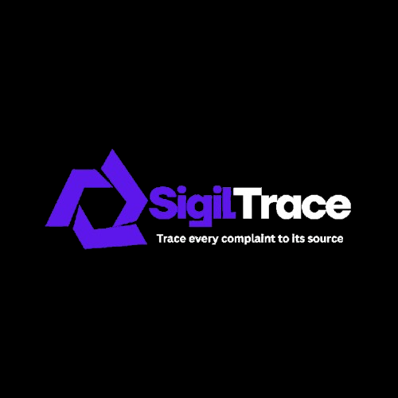

# SigilTrace backup and restore procedure

BR-001, Rev A (draft), October 2026. Supports OPS-001, OPS-002, and OPS-005 in SRS-001 and the Backup and recovery section of DS-001. Items in \[brackets\] are open.

## Purpose

This procedure defines how SigilTrace's data is backed up, how backups are checked, and how data is restored after a failure, so that customers' complaints, CAPAs, signatures, and audit trails can be recovered intact. A backup that has never been restored is not proof of anything, so restore testing is part of the procedure.

## Scope

- The production database, including the audit log and its chain

- File storage: attachments, stored original emails, and the reference library

- Configuration and infrastructure definitions

- Secrets, which are held in the managed secrets store and are not copied into ordinary backups

## Targets

These are proposed and must be confirmed before the first customer.

| Target | Proposed value |
|----|----|
| Maximum data loss (recovery point) | \[15 minutes\], using point-in-time recovery for the database |
| Time to restore service (recovery time) | \[8 hours\] |
| Backup retention | \[35 days\] |
| Location | United States only, in a separate zone or region from production \[region to be chosen\] |

## Backup arrangements

- **Database:** automated daily backups plus continuous point-in-time recovery, encrypted with managed keys

- **File storage:** versioning and deletion protection turned on, so a file cannot be silently overwritten or removed, and the stored original emails are protected the same way

- **Infrastructure and configuration:** kept as code under version control, so the environment can be rebuilt

- **Access:** only named administrators can read or restore backups, and every such action is logged

- **Monitoring:** each backup job reports success or failure, and a failure raises an alert and is treated as an incident under INC-001

## Restore testing

Restore tests happen at least \[quarterly\] and after any change to the backup arrangements:

1.  Choose a backup, or a point in time, that the tester has not announced in advance.

2.  Restore the database and file storage into a separate test environment, never into production.

3.  Run the audit chain verification and confirm it passes.

4.  Compare record counts and a sample of records, signatures, and attachments with the source, including a few signed records and their fingerprints.

5.  Sign in, open records, and run an export to confirm the restored system works.

6.  Record the time taken against the recovery time target.

7.  Write a short report with the result, any defects, and follow-up actions. Raise defects through CC-001 or INC-001.

8.  Delete the test environment and its data.

The results are the evidence for test cases T-OPS-01 and T-OPS-02.

## Restoring production

1.  The incident lead declares the need and approves the restore. The reason and the chosen restore point are recorded.

2.  Preserve the damaged state for investigation where possible.

3.  Restore to a new environment, verify it as in the restore tests, then switch over.

4.  Replay anything received after the restore point. Inbound emails are kept as stored originals and can be processed again, and duplicate detection prevents double entries.

5.  Tell affected customers what was restored, to what point, and what they may need to re-enter. Remind them that their own awareness dates and reporting deadlines are not paused by an outage or a restore.

6.  Verify the audit chain and record the restore itself in the audit trail.

7.  Complete the incident review under INC-001.

## Retention and deletion

Backups are kept for the retention period above and then expire automatically. Customer record retention periods (OPS-005) apply to live data. Where a customer asks for data to be deleted, the live data is handled under its agreement and retention rules, and the data in backups ages out on the backup schedule. This must be explained in customer agreements \[wording to be agreed with legal counsel\].

## Records

Backup logs, restore test reports, approvals, and restore records are kept for \[period\].

## Revision history

| Revision | Date | Description |
|---|---|---|
| A | October 2026 | First draft |

## Review and approval

| Role                 | Name     | Signature     | Date     |
|----------------------|----------|---------------|----------|
| Author               | \[name\] | \[signature\] | \[date\] |
| Independent reviewer | \[name\] | \[signature\] | \[date\] |

## Open items

- Confirm the recovery targets, retention, and restore test frequency

- Choose the backup region or zone

- Agree the wording on deletion and backups with legal counsel
