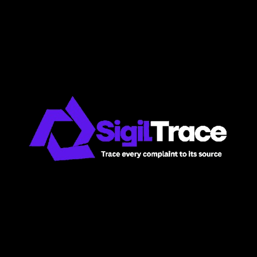

# Qaabil validation package fix report

Report date: 2026-11-07

## Changes applied

| File | Section | Old → new |
|---|---|---|
| `validation/SRS-001.md` | Front matter | `status: unspecified` → `status: draft` |
| `validation/SRS-001.md` | Preamble | No body byline → `SRS-001, Rev A (draft), October 2026.` |
| `validation/SRS-001.md` | Purpose | `Qaabil version A` → `Qaabil version 1` |
| `validation/SRS-001.md` | Purpose | V1 scope without usage, rule-set, or email wording → added `for English-language use`, `reportability rule sets`, and `email intake` exactly as directed |
| `validation/SRS-001.md` | ESG-001 | Re-authentication required at signing → re-authentication immediately before signing, valid no more than 5 minutes |
| `validation/SRS-001.md` | CMP-002 | Awareness time recorded automatically at receipt → receipt time recorded automatically, awareness time defaulted and confirmed under EML-008, with reason and audit controls |
| `validation/SRS-001.md` | Audit trail | No AUD-007 → added the cryptographic-chain and scheduled-verification requirement |
| `validation/SRS-001.md` | Email intake | No EML section → added EML-001 through EML-010 |
| `validation/SRS-001.md` | Security | SEC table ended at SEC-007 → added SEC-008 and SEC-009 |
| `validation/SRS-001.md` | Review and approval | No approval block → added Author, Independent reviewer, and Regulatory advisor rows |
| `validation/RA-001.md` | Purpose | `teesting` → `testing` |
| `validation/RA-001.md` | RSK-005 controls | `AGT-009, AGT-013, change control in the validation plan` → added `AUD-006` |
| `validation/RA-001.md` | RSK-008 controls | `ACC-001, ACS-002, ACS-003` → added `ACS-001` |
| `validation/RA-001.md` | RSK-011 controls | `ESG-003, ESG-004, AUD-001, AUD-003` → added `ESG-002` |
| `validation/RA-001.md` | RSK-012 controls | `AUD-001, AUD-002, AUD-003, AUD-004` → added `AUD-005, AUD-007` |
| `validation/RA-001.md` | RSK-013 controls | `CMP-002, CMP-007, OPS-003, new RUL-001` → removed `new` from `RUL-001` |
| `validation/RA-001.md` | RSK-016 controls | `AUD-004, OPS-001, OPS-002, OPS-005` → added `EML-002, OPS-006` |
| `validation/RA-001.md` | RSK-019 controls | `ACC-007, AUD-001` → added `ACS-004` |
| `validation/RA-001.md` | RSK-021 controls | `ACC-003, ACC-004, ACC-005` → added `ACC-002` |
| `validation/RA-001.md` | RSK-022 controls | `SEC-001 to SEC-007` → `SEC-001 to SEC-009` |
| `validation/RA-001.md` | RSK-023 controls | `CMP-007, PRD-002, new RUL-001, new RUL-002` → removed both `new` markers |
| `validation/RA-001.md` | RSK-024 controls | `CMP-006, CMP-010, AGT-005, new AGT-014` → `CMP-006, CMP-010, AGT-005, AGT-014, LNG-001, LNG-002` |
| `validation/RA-001.md` | Risk register | Register ended at RSK-024 → added RSK-025 through RSK-028 with the supplied scores, controls, and residual values |
| `validation/RA-001.md` | Residual-risk paragraph | Existing two-sentence paragraph → appended the supplied provenance sentence for RSK-025 through RSK-028 and added trace links |
| `validation/RA-001.md` | Open items | `Add RUL-001, RUL-002, and AGT-014 to the requirements specification and update ENT-002` → removed |
| `validation/TC-001.md` | Common preconditions | `US and one other test market` → `US and one synthetic second test market, used only to test multi-market logic` |
| `validation/TC-001.md` | After Email intake | File ended after T-EML-10 → appended the supplied 38 tests, execution record, approval table, and open items |
| `compliance/P11-001.md` | 11.10(k) | `[Change control procedure to be written]`; `Procedure needed` → `CC-001 (drafted)`; `Procedure drafted` |
| `compliance/P11-001.md` | Gaps and actions | Procedure bullet said both procedures remained to be written → vendor procedure remains open and CC-001 is drafted and needs review |
| `compliance/P11-001.md` | Open items | `Write the vendor training and change control procedures` → `Write the vendor training procedure and review CC-001` |
| `validation/ADS-001.md` | Review and approval | No approval block → added Author, Independent reviewer, and Regulatory advisor rows |
| `validation/DS-001.md` | Review and approval | No approval block → added Author and Independent reviewer rows |
| `validation/TP-001.md` | Review and approval | No approval block → added Author, Independent reviewer, and Regulatory advisor rows |
| `validation/VP-001.md` | Review and approval | No approval block → added Author, Independent reviewer, and Regulatory advisor rows |
| `validation/ADS-001.md` | Open questions | `Which rule sets ship in v1: US only, or EU as well?` → US-only v1 decision; EU deferred |
| `validation/VP-001.md` | Intended use | English-only statement → appended `Version 1 includes the US reportability rule set only.` |
| `planning/MVP.md` | Below title | No control-status note → added the supplied uncontrolled-document and DS-001 decision note |
| `planning/complaint-handling.md` | New document | File absent → created the supplied uncontrolled planning note with only the requested `id` and `status` front matter |
| `register.md` | SRS-001 row | Status `unspecified` → `draft` |
| `register.md` | Planning row | No complaint-handling entry → added `planning-complaint-handling` as uncontrolled Markdown |
| `register.md` | TM-001 note | No legacy-name note → recorded `RTM-001 Rev A Draft.docx` as the legacy desktop file name |
| `decision-log.md` | New report | File absent → generated 166 bracketed-placeholder occurrences, grouped by controlled document and section, without resolving them |

## Not applied

- `validation/RA-001.md`, section B5: `Decide which languages the agent and keyword check support in v1` was not present, so no removal was attempted.
- `validation/RA-001.md`, section B6: no approval block was added because the document already contained one.

## Verification results

| Check | Result | Details |
|---|---|---|
| SRS-001 requirement count and distribution | PASS | 102 total: ACC 8, ACS 5, ESG 5, AUD 7, CMP 11, EML 10, NCR 4, CAPA 8, PRD 2, RUL 2, AGT 14, LIB 3, ENT 3, EXP 3, LNG 2, SEC 9, OPS 6 |
| SRS-001 duplicates and sequence gaps | PASS | No duplicate requirement IDs and no gaps within any required prefix |
| RA-001 risk sequence | PASS | RSK-001 through RSK-028 are present with no gaps |
| RA-001 Controls cells | PASS | All 28 cells exactly match section B2; every requirement ID named in them exists in SRS-001 |
| Test-case totals | PASS | TC-001 has 83 test cases; TC-002 has 19 |
| TM-001 test references | PASS | Every test ID cited in TM-001 exists |
| Requirement references across TM-001, RA-001, DS-001, P11-001, TC-001, and TC-002 | FAIL | ESG-006 is cited in TM-001 and P11-001 but does not exist in SRS-001; no change was authorized |
| SRS-001 requirements represented in TM-001 | PASS | All 102 requirements appear in TM-001 |
| SRS-001 requirements covered by tests | PASS | Every requirement appears in at least one TC-001 or TC-002 test case |
| Risk references in TM-001 and test cases | PASS | Every cited risk ID exists in RA-001 |
| SRS-001 and TM-001 R values | PASS | All values match; ENT-002 is M in both documents |
| Forbidden controlled-document text | PASS | No controlled document contains `Draft v0.1`, `version A`, `teesting`, or `[Change control procedure to be written]` |
| Required approval blocks | PASS | ADS-001, DS-001, SRS-001, TC-001, TP-001, and VP-001 contain Review and approval tables |
| Pipe-table structure | PASS | Every Markdown table row has the same cell count as its header |
| Decision log completeness | PASS | 166 logged occurrences exactly match the 166 bracketed occurrences in the controlled documents |
| Sensitive-data screen | PASS | No credential, private-key, access-token, email-address, phone-number, or SSN pattern was introduced |

## Intentionally not changed

- L-01: existing SRS-001 table styling was not changed.
- L-02: running headers and footers were not added to the Markdown documents.
- L-03: the source MVP PDF layout was not changed.
- L-06: core-title wording was not changed.
- M-02: TM-001 remains the controlled ID; only the required legacy desktop file-name note was added to `register.md`.

## New items noticed but not changed

- `ESG-006` is explicitly described as a proposed requirement in P11-001 and is mentioned in TM-001, but it is absent from SRS-001. This is the sole failed required verification check. The patch did not authorize adding ESG-006 or removing those citations.
- `.DS_Store` and `qaabil-fix-patch.md` remain untracked working files. Neither was imported into the package or edited.
