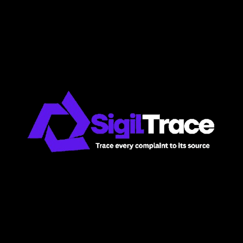

# SigilTrace validation plan v1 (complaints, CAPA, NCR, triage agent)

Rev A (draft), October 2026. Items in \[brackets\] are to be completed. Applicability of standards to any customer is that customer's decision, and regulatory content should be reviewed by a qualified quality or regulatory professional.

## Purpose

Define how SigilTrace v1 will be planned, built, tested, and released under control, and what evidence will be produced so customers can rely on it and reuse it for their own intended-use validation.

## Intended use

SigilTrace is web-based quality system software for small medical device manufacturers. It records and manages complaints, nonconformance reports, and corrective and preventive actions, and offers an AI-assisted triage agent that proposes classifications, severity, and reportability for a qualified person to review and approve. The software does not make regulatory decisions, does not submit reports to regulators, and is not a medical device. Version 1 supports English-language content only. Version 1 includes the US reportability rule set only.

## Scope

In scope for v1:

- User accounts, roles, and separation of each company's data

- Electronic signatures and audit trail

- Complaint records and workflow

- NCR records

- CAPA records, actions, and effectiveness checks

- The triage agent and its review screen

- Reference library of uploaded procedures, read-only

- Export to PDF and CSV

- Email intake with a draft complaint inbox

- Reportability rule sets (version 1 includes the US rule set only)

- Product records and entitlements

- English-language use

Out of scope for v1, as product features: document control, risk management and FMEA, monitoring, change control, supplier management, traceability integrations, and regulatory report submission. SigilTrace's own change control and supplier assessment follow CC-001 and SA-001. Each of these will have its own validation activities if and when it is released.

## Basis

This plan draws on the quality system software validation expectations in ISO 13485, the electronic records and signatures requirements in 21 CFR Part 11, FDA's computer software assurance approach, and GAMP 5 as a reference framework. IEC 62304 is not a requirement for this software, but its lifecycle discipline is borrowed where useful.

## Roles

- Developer and system owner: \[name\]

- Independent reviewer and approver of the validation documents: \[name or external consultant\]. Where one person fills several roles, this will be stated in the validation summary report together with the compensating controls.

- Regulatory advisor for the reportability rule content: \[name\]

## Risk-based approach

Each requirement is assigned a risk level using severity, likelihood, and detectability. Assurance effort follows risk:

- High risk: scripted tests with recorded evidence. Examples: electronic signatures, audit trail, access control and tenant isolation, the urgent-complaint flag, deadline calculations, and the triage agent's reportability proposals.

- Medium risk: scripted or automated tests. Examples: complaint and CAPA workflows, linking between records.

- Low risk: exploratory testing with notes. Examples: display preferences and cosmetic features.

AI-specific risks to assess include: a missed urgent flag, a wrong reportability proposal, an invented citation, prompt injection through complaint text, data exposure between companies, and drift when a model or prompt changes.

## Deliverables

| Deliverable | Purpose |
|----|----|
| Validation plan (this document) | Approach and responsibilities |
| User and software requirements | What the system must do, with unique IDs |
| Part 11 control matrix | How each applicable control is met |
| Risk assessment | Hazards, ratings, and mitigations |
| Architecture, data model, and security design | How the system is built |
| Triage agent design and test set | Agent behavior, limits, and test cases |
| Test plan and test cases | What will be tested and how |
| Test results and defect log | Evidence and open issues |
| Traceability matrix | Requirements to risks to tests |
| Release notes | What changed in each release |
| Validation summary report | Conclusion and approval for release |

Document numbers: VP-001 (this plan), SRS-001, RA-001, DS-001, ADS-001, P11-001, TP-001, TC-001, TC-002, TM-001, TR-001, RN-001, VSR-001, and CVP-001. Operating procedures: CC-001, INC-001, SA-001, and BR-001.

## Test strategy

- Automated unit and integration tests run on every change in the build pipeline

- System tests against each requirement, with recorded results

- Part 11 tests: signature requires re-authentication, signed records show name, date, time, and meaning, edits after signing are blocked or versioned, and every change creates an audit entry with before and after values

- Tenant isolation tests: a user in one company can never read or write another company's records, including through direct links and the API

- Entitlement tests: a company without an add-on cannot reach its screens or data

- Agent tests: the agent test set described in the triage spec, with acceptance criteria agreed with the regulatory advisor, including non-English and mixed-language complaints, all of which must be flagged for manual review

- Security checks: dependency scanning, secrets handling, and a penetration test before first customer use

- Operational tests: backup and restore, and recovery of the audit trail

## Agent acceptance criteria (starting targets)

- Every death, serious injury, and hospitalization case in the test set is flagged urgent

- No truly reportable case is proposed as not reportable without being flagged for review

- Key field extraction meets thresholds set per field with the regulatory advisor

- Every proposal cites its source or states that support is missing

- The test set is re-run after any model, prompt, or retrieval change, and results are recorded

The controlling acceptance criteria are those in TC-002.

## Release criteria

- All high-risk tests passed

- No open critical or major defects

- Open minor defects documented with rationale

- Traceability matrix complete with no untested requirement

- Validation summary report reviewed and approved by someone other than the author, or with compensating controls noted

## Change control after release

- Every change is classified by its impact on validated functions

- Regression tests cover the affected functions and all high-risk functions

- Each release has a version number and release notes, and customers are notified before changes that affect validated behavior

- Hotfixes follow an expedited path with documented rationale and a follow-up review

## Operational controls

- Backups with periodic restore tests

- Incident and defect management with severity levels

- Access reviews for the vendor's own administrative accounts

- Assessment of suppliers, including the cloud host and the AI model provider, with their data handling terms recorded

- Periodic review of this plan, at least annually and after any major release

## Customer validation package

Contents: intended use statement, Part 11 control matrix, requirements and traceability summary, test summary, release notes, security overview, AI limitations and test results, a responsibilities table showing what the vendor covers and what the customer must still do, and a test script template customers can run for their own intended-use validation.

## Records

All validation documents are version controlled, signed, and retained for \[period\]. Superseded versions are kept and marked as such.

## Revision history

| Revision | Date | Description |
|---|---|---|
| A | October 2026 | First draft |

## Review and approval

| Role | Name | Signature | Date |
|---|---|---|---|
| Author | [name] | [signature] | [date] |
| Independent reviewer | [name] | [signature] | [date] |
| Regulatory advisor | [name] | [signature] | [date] |

## Open items

- Name the independent reviewer

- Choose the tool for requirements, tests, and traceability during v1

- Confirm the retention period for validation records

- Agree the agent's acceptance thresholds with the regulatory advisor
